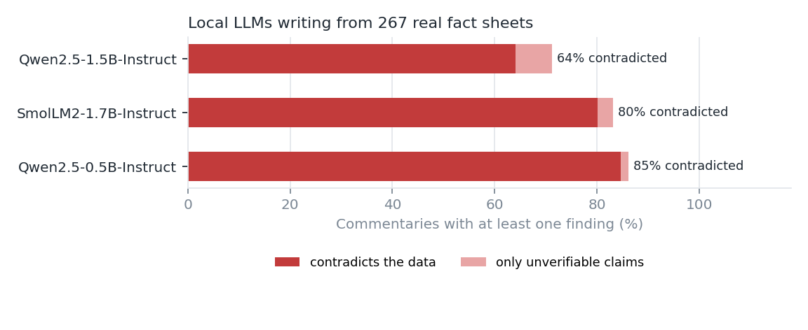
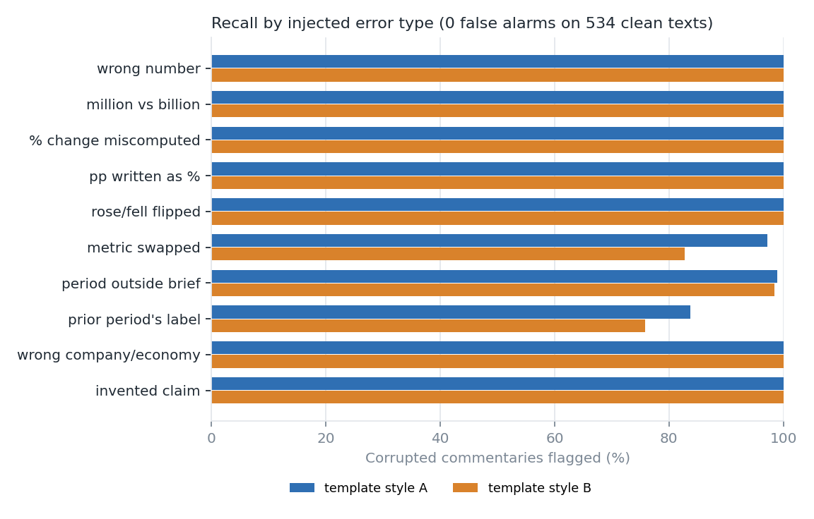

# finllm-qa: fact-checking LLM-written financial commentary

LLMs write fluent market commentary, and they get the numbers wrong in ways a reader rarely
notices: a 15.1% rise reported as 16%, a fall described as a rise, last year's figure under this
year's label. **finllm-qa** checks a piece of commentary against the source data it was written
from and points at every claim it cannot trace back.

It runs on real data: 791 facts from **SEC EDGAR** (annual revenue, net income and diluted EPS
for 15 large US companies) and **FRED** (CPI, core CPI, unemployment, payrolls, fed funds,
Treasury yields, WTI crude, GDP), grouped into 267 "briefs" such as *Apple, fiscal 2025 vs 2024*
or *US inflation, September vs August 2026*.

## Results: three small LLMs, 801 commentaries

Three open-weight models, run locally on an 8 GB laptop GPU with greedy decoding, each wrote a
commentary for every brief. The prompt says to use **only** the facts given and to add no numbers,
dates or claims. **Three commentaries in four (76%) still contain a claim the data contradicts.**



| Model | Commentaries | With a contradicted claim | Numbers traced to the brief | Most frequent errors |
| --- | --- | --- | --- | --- |
| Qwen2.5-1.5B-Instruct | 267 | 64.0% | 88.9% of 1,061 | direction (148), % change (59), metric (32) |
| SmolLM2-1.7B-Instruct | 267 | 80.1% | 71.7% of 1,089 | direction (256), wrong number (155), % change (89) |
| Qwen2.5-0.5B-Instruct | 267 | 84.6% | 65.3% of 776 | direction (270), wrong number (151), period (49) |

The errors are the kind a busy reader misses (verbatim):

- *"The US effective fed funds rate has increased from 4.33% in August 2025 to 4.22% in September
  2025"* (SmolLM2): a fall written up as a rise, the most common error by far.
- *"Revenue increased by 19% to USD 198,270 million"* (Qwen2.5-1.5B, Microsoft fiscal 2022): the
  rise was 18.0%.
- *"declined by USD 2.03 per barrel, or 2.9%"* (SmolLM2, WTI November 2024): 2.9% divides by the
  new price; the fall was 2.8%.
- *"the 2.5% decline observed in June"* (SmolLM2): June is not in the brief; the figure is invented.
- *"crude falling by approximately 3.5% to USD 80.46 per barrel"* (Qwen2.5-1.5B, August 2026): oil
  rose 4.3%, from 80.46; the two months are swapped.

### How far to trust the checker

Every finding and miss was judged by hand on **SmolLM2**, the one model not read during
development (Qwen outputs were used to find parser bugs). The sample is 60 findings and 45
unflagged commentaries, each with a one-line reason in [`reports/audit.csv`](reports/audit.csv).

| Audit, checker as of commit `ae88bc0` | Count |
| --- | --- |
| Findings that are real errors | 49 of 60 |
| Findings that are claims absent from the brief (the instruction was broken) | 4 of 60 |
| False alarms | 7 of 60 (precision 88%) |
| Unflagged commentaries that still contain an error | 13 of 45 |

The audit led to five fixes: binding a number to a period across a comma or "to", the clause
"which excludes food and energy prices", the noun "acceleration", adjectives such as "increased
costs", and job gains described in percentage points. Re-run on the same 105 cases, 5 of the 7
false alarms and 9 of the 13 misses are gone and no correct text is newly flagged. That re-check
is optimistic, since the fixes were written from these cases; a fresh audit on another model is
the honest next measurement. Misses that remain are mostly claims with no number at all ("the
core rate showing a higher rate of increase", "a strengthening dollar").

## What it checks

```
commentary ──► numbers with units ──► linked to a metric ──► matched against the brief
               ($416.2bn, 6.4%,       ("revenue", "core      (levels, prior values, changes,
               25 bp, 151,000 jobs)    CPI", "10-year")       % changes, margins, spreads)
           ──► direction words ("rose", "slowed", "unchanged") vs the sign of the actual change
           ──► periods and companies named vs the ones the brief covers
           ──► claims about expectations or records the brief does not contain
```

Each finding is **contradicted** (the data says otherwise) or **unverifiable** (the brief does not
contain it), with a diagnosis:

| Error | Example caught |
| --- | --- |
| wrong number | revenue "$461.2 billion" for $416.2 billion |
| million vs billion | "$59.972 million" for $59.97 billion |
| % change miscomputed | "surged by 16%" for +15.1%; divided by the new value instead of the old |
| percentage points as % | yields "rose 0.31%" for +0.31 percentage points |
| direction | "net income rose to $19.9bn from $20.9bn" |
| metric swapped | net income quoted with revenue's figure |
| wrong period | the fiscal 2025 figure labelled fiscal 2024 |
| wrong company | Microsoft's revenue in an Apple note |
| rounding | "$59.9 billion" for $59.97 billion (truncated, not rounded) |
| unsupported | "beat the consensus estimate", "highest since 2008", any number not in the brief |

Rounding is judged by the precision written: "$416bn" and "$416.2bn" both match $416.161bn,
"$416.0bn" does not. Hedged numbers ("about 11%") get 3% slack. "Consumer prices rose 3.7%"
describes the level, "inflation rose to 3.7%" the change; "down from 6.3% in January" binds the
number to the earlier month; "since August" starts a range and binds nothing.

## Synthetic benchmark

Every brief is written up as correct commentary by templates in two house styles, then each text
is corrupted with exactly one labelled error of each applicable type (534 correct and 3,205
corrupted documents):



| Injected error | Docs (A / B) | Flagged, style A | Flagged, style B | Right sentence and type, A / B |
| --- | --- | --- | --- | --- |
| wrong number | 265 / 265 | 100.0% | 100.0% | 89.8% / 84.9% |
| million vs billion | 79 / 79 | 100.0% | 100.0% | 100.0% / 100.0% |
| % change miscomputed | 105 / 99 | 100.0% | 100.0% | 97.1% / 93.9% |
| pp written as % | 42 / 68 | 100.0% | 100.0% | 100.0% / 100.0% |
| rose/fell flipped | 183 / 32 | 100.0% | 100.0% | 100.0% / 100.0% |
| metric swapped | 105 / 122 | 97.1% | 82.8% | 97.1% / 82.8% |
| period outside brief | 265 / 264 | 98.9% | 98.5% | 98.9% / 98.5% |
| prior period's label | 251 / 248 | 83.7% | 75.8% | 83.7% / 75.8% |
| wrong company/economy | 120 / 79 | 100.0% | 100.0% | 100.0% / 100.0% |
| invented claim | 267 / 267 | 100.0% | 100.0% | 100.0% / 100.0% |
| none (clean text): false alarms | 267 / 267 | 0.0% | 0.0% | |

High recall here is expected and is not the headline: the corruptions mirror the checks. The
point of the benchmark is the **zero false alarms on 534 correct texts** and a regression suite
(`tests/test_benchmark.py`) that keeps it that way. Both template styles were used while
developing the checker, so neither is a true held-out set; the real test is LLM-written text.

## Run it

```bash
pip install -e ".[dev]"
python -m finllm_qa check Apple-FY2025 "Apple's revenue rose 16% to \$416.2 billion in fiscal 2025."
python -m finllm_qa benchmark          # synthetic benchmark -> reports/
pytest -q                              # 35 tests, offline, on the committed fact table

# optional: local LLMs on your GPU (weights from Hugging Face, no API key, no cost)
pip install -e ".[llm]"
python -m finllm_qa generate --model Qwen/Qwen2.5-1.5B-Instruct
python -m finllm_qa score-llm
python -m finllm_qa build-facts         # refresh data/facts.csv from FRED and SEC EDGAR
```

## Layout

| File | Role |
| --- | --- |
| `sources.py`, `facts.py` | Download FRED series and SEC XBRL company facts; build `data/facts.csv` (fiscal years from 10-K filings, latest restatement wins) |
| `briefs.py` | Group facts into briefs and list every number a faithful text may derive from them |
| `numbers.py` | Read numbers with currency, scale, percent, basis points, job counts and written precision; read periods |
| `metrics.py` | The metrics and the words commentary uses for them; direction words |
| `checker.py` | Link numbers and verbs to metrics, match against the brief, diagnose mismatches |
| `templates.py`, `corrupt.py`, `evaluate.py` | Synthetic benchmark |
| `llm.py`, `report.py` | Local LLM generation and scoring |

## Limitations

- Linking a number to its metric is heuristic (nearest mention, period binding by proximity).
  Long sentences that list several metrics "respectively" are checked leniently.
- The sign of a figure is checked through direction words, not the number: "a loss of 20,000
  jobs" written as "20,000 jobs" is not caught.
- Non-numeric claims are checked only for periods, companies and a list of words that signal
  expectations or records. Causal stories ("driven by AI demand") pass unexamined.
- Macro y/y inflation is computed from seasonally adjusted CPI, so it can differ by a few
  hundredths from the headline BLS figure.

Data: SEC EDGAR XBRL company facts and FRED (public-domain series from BLS, BEA, the Federal
Reserve, the Treasury and EIA). MIT licence.
